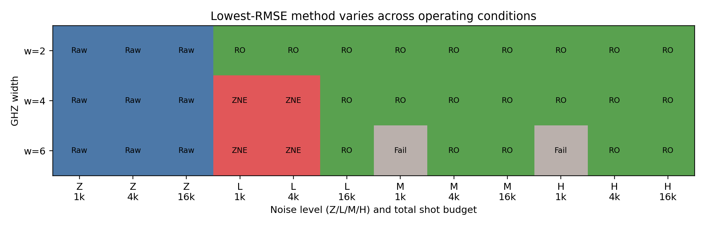

# Adaptive QEM Benchmark

A reproducible simulator study of when quantum error mitigation helps, wastes a fixed
shot budget, or fails explicitly.

The benchmark compares raw estimation, full-assignment-matrix readout mitigation, and
linear zero-noise extrapolation (ZNE) for GHZ and fixed-seed hardware-efficient
circuits. It crosses widths 2, 4, and 6; depths 1, 3, and 6 where applicable; multiple
noise regimes; total budgets of 1,024, 4,096, and 16,384 shots; and 50 deterministic
repeats.

## Verified result

Across 144 GHZ and hardware-efficient operating cells, the cost-aware oracle found
103 practical ties, 18 readout winners, 14 ZNE winners, and 9 inconclusive cells.
The frozen rule selector achieved 41.4% decision compatibility on a deterministic
29-cell holdout, with mean RMSE regret 0.0207 and median regret 0.000397. Under four
unseen noise shifts, decision compatibility was 50.0%, mean regret was 0.00771, and
median regret was zero. These are diagnostic baseline results, not evidence of a
generally reliable adaptive policy.

The hardware-efficient run retained 99 explicit readout failures, concentrated in
width-6, low-shot, medium/high-noise cells. Negative mitigation gains are also kept:
179 of 432 method summaries had worse RMSE than the raw estimator.

A preregistered combined-QEM study compares raw, readout, ZNE, and readout-plus-ZNE
under the same 4,096- and 16,384-shot budgets. Combined QEM had the lowest expectation
RMSE in 12 of 16 circuit/budget/allocation cells, but all 16 combined-ZNE validity
assessments were rejected by at least one frozen negative-control criterion. On the
0.02-margin decision task, combined mitigation produced error rates from 0.26 to 0.48
and did not consistently improve on readout mitigation. These simulated results show
estimation gains, not credible universal ZNE behavior or improved decisions.



Read the full paper: **[Adaptive Quantum Error Mitigation Under Fixed Shot Budgets](paper/main.pdf)**

## Evidence boundary

- **Analytic:** Bell/GHZ stabilizer expectations and shot-noise relations.
- **Noiseless simulated:** statevector references and folding equivalence checks.
- **Noisy simulated:** all finite-shot benchmark results, using idealized Qiskit Aer
  readout and depolarizing channels.
- **Hardware-derived:** none.

The noise levels are controlled study parameters, not calibrations from an IBM or
other physical device.

## Methods and resource accounting

- Raw estimation spends the full budget on the target circuit.
- Readout mitigation spends 20% on all `2^w` calibration states and 80% on the target.
- Linear ZNE splits the same total budget across global folds 1, 3, and 5 and retains
  unclipped extrapolates.
- Combined mitigation reserves 20% for assignment-matrix calibration, then allocates
  the remainder across folds using frozen balanced or base-heavy policies.
- Every stochastic seed derives from root seed `20261102`.
- Failed, raw, corrected, and factor-level observations remain explicit.

## Reproduce

Python 3.11 or 3.12 is required. The expanded nontrivial-circuit generation took about
43 minutes on the development desktop; runtime is machine-dependent.

```powershell
python -m venv .venv
.\.venv\Scripts\python.exe -m pip install -r requirements-ci.txt
$env:MPLBACKEND = "Agg"
$env:MPLCONFIGDIR = ".matplotlib-cache"

.\.venv\Scripts\python.exe -m coverage run -m pytest
.\.venv\Scripts\python.exe -m coverage report
.\.venv\Scripts\python.exe -m src.run_with_log src.generate_artifacts
.\.venv\Scripts\python.exe -m src.run_with_log src.regenerate_readout_affected
.\.venv\Scripts\python.exe -m src.run_with_log src.generate_paper_assets
.\.venv\Scripts\python.exe -m src.run_with_log src.generate_runtime_report
.\.venv\Scripts\python.exe -m src.run_with_log src.generate_audit_manifest
.\.venv\Scripts\python.exe -m src.run_with_log src.generate_nontrivial_benchmark
.\.venv\Scripts\python.exe -m src.run_with_log src.generate_adaptive_analysis
.\.venv\Scripts\python.exe -m src.run_with_log src.generate_zne_probability_diagnostics
.\.venv\Scripts\python.exe -m src.run_with_log src.generate_zne_falsification
.\.venv\Scripts\python.exe -m src.run_with_log src.generate_zne_validity_gate
.\.venv\Scripts\python.exe -m src.run_with_log src.generate_combined_qem
.\.venv\Scripts\python.exe -m src.run_with_log src.readout_scalability_metrics
.\.venv\Scripts\python.exe -m src.run_with_log src.generate_readout_tensor_validation
.\.venv\Scripts\python.exe -m src.run_with_log src.generate_readout_subspace_validation
.\.venv\Scripts\python.exe -m src.run_with_log src.generate_readout_matrix_free_validation
.\.venv\Scripts\python.exe -m src.run_with_log src.generate_readout_scalability_benchmark
tectonic paper/main.tex --outdir paper
```

Verify committed deterministic outputs:

```powershell
python -m src.verify_generated_artifacts --current
python -m src.verify_generated_artifacts --include-expensive
```

The second command includes the approximately 35-minute width-scalability benchmark.
Routine CI validates its committed schema and coverage through the test suite without
rerunning that expensive grid on every push.

`results/processed/day08_12_audit_manifest.csv` is generated from the repository
artifacts. It records deterministic paths, byte sizes, SHA-256 hashes, and parsed CSV
data-row counts; values are not maintained by hand.

## Generation run logs

Each wrapped generation command writes a compact JSON record under `results/runs/`.
The record contains timing, environment and Git metadata, status, and SHA-256 hashes
for files written under `results/` and `figures/`; it does not embed result data.

```powershell
ls results/runs/
```

## Limitations

This is a simulator-only benchmark. It does not model device drift, leakage,
relaxation, calibrated hardware noise, or calibration uncertainty. The structured
noise-shift study adds asymmetric readout, coherent over-rotation, and correlated-ZZ
controls, but these remain synthetic models. Declared GHZ depths 3 and 6 remain
`not_applicable`; hardware-efficient circuits supply the nontrivial depth grid.
Full-matrix calibration scales exponentially with width. Aggregate metrics are
conditional on completed rows, while operating-cell labels require all methods to
complete all 50 repeats.

The scalable-readout track contains a frozen width-2--12 protocol, analytic resource
estimates, width-2/4 full-matrix feasibility references, and a 20-repeat tensor-product
validation at widths 2, 4, and 6. Under independent and asymmetric per-qubit readout
models, tensor correction had lower RMSE in 19 of 24 fixed-budget cells while using
`2*w` rather than `2**w` calibration circuits. This validates the implementation in
its assumed model; it is not evidence of robustness to correlated readout.

The observed-subspace study adds 50-repeat full-matrix comparisons at widths 2, 4,
and 6 and 10-repeat sparse pilots at widths 8 and 10. Support is selected only from
noisy target counts with a frozen minimum count of two. All 2,480 rows completed under
their declared shot budgets. Mean retained support fell to 22.6% at width 8 and 8.3%
at width 10 for sparse outputs, while expectation RMSE increased with width. The
result demonstrates a classical memory reduction, not a quantum-shot saving, and
does not establish robustness to broad or correlated-error cases. Correlated-mismatch
outcomes are not yet available.

The matrix-free validation applies tensor-factorized assignment operators without
forming a support-square matrix. All 1,280 planned rows converged with exact shot
accounting and zero materialized matrix entries; observed iterations rose from a
width-2 mean of 23.3 to a width-10 mean of 94.6. This validates deterministic solver
behavior for independent and asymmetric local readout models. It does not establish
an advantage under correlated errors, and the length-`2**w` working vector remains
exponential. Correlated-mismatch outcomes are not yet available.

The unified width-2--12 scalability benchmark contains 5,760 repeat-level rows. Full
matrix correction completes 1,242 rows, fails 38 width-8 repeats as ill-conditioned,
and is resource-limited for 160 width-10/12 rows. Dense observed-subspace correction
is resource-limited for 140 rows whose count-derived support exceeds 128 and fails
two additional width-12 rows. Tensor and matrix-free correction complete all 1,440
rows each. At width 8, mean measured full-matrix solve time is 10.9 seconds versus
0.057 seconds for matrix-free correction. Every method amplifies sampling standard
deviation on average; lower classical storage therefore does not imply lower
statistical uncertainty. These conclusions remain limited to synthetic independent
and asymmetric local readout errors.

The correlated-mismatch stress test adds 9,600 paired rows at widths 2, 4, and 6.
It compares full, tensor-product, observed-subspace, and matrix-free correction under
matched independent, asymmetric, pair-correlated, and deliberately mismatched
calibration channels. All methods use the same 20/80 calibration/target budget split.
For the representative width-6 broad-output, 16,384-shot cell, calibration mismatch
raises expectation RMSE to 0.074--0.078 and the error probability of a preregistered
0.05-margin threshold decision to 0.88--0.94. This is simulated evidence that reduced
classical storage cannot compensate for a wrong calibration model; it is not a
hardware-robustness claim.

## Repository structure

```text
src/                         Benchmark and mitigation implementations
tests/                       Analytic, statistical, and reproducibility invariants
experiments/                 Frozen configuration and manifest
results/raw/                 Immutable repeat-level benchmark rows
results/processed/           Coverage and runtime summaries
results/runs/                Per-run generation metadata and output hashes
figures/                     Generated project figures
paper/main.tex               Technical paper source
paper/main.pdf               Compiled paper
paper/generated/             Tables and macros derived from authoritative CSV data
paper/figures/               Paper figures generated from repository outputs
```

The project contains no license file because repository licensing intent has not been
established.
